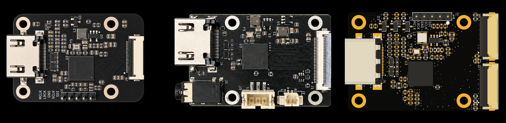

# RK628H HDMI to MIPI CSI-2 bridge boards

Three small boards that turn an HDMI source into a MIPI CSI-2 camera stream,
built around the Rockchip RK628H. We designed them while building
[WarpKVM](https://warpkvm.com), used them to write and measure our capture
pipeline, and they are released here as open hardware so anyone can build on
them.

| | [`rk628-22p`](rk628-22p/) | [`rk628-30p`](rk628-30p/) | [`rk628-2x22p`](rk628-2x22p/) |
|---|---|---|---|
| Host connector | 22-pin FPC, 0.5 mm | 30-pin FPC, 0.5 mm | Two 22-pin FPCs, 0.5 mm |
| CSI-2 link | 4 lanes | 4 lanes | 2 x 4 lanes |
| Best mode | 4K30, 1080p120 | 4K30, 1080p120 | 4K60 (captured on the DIY shield) |
| Audio | I2S header | On-board DAC, 3.5 mm jack | I2S header |
| Size | 45 x 30 mm | 46.25 x 30 mm | 49 x 32.5 mm |
| Tested on | Luckfox Aura (RV1126B), Raspberry Pi CM4, Pi 4B lane count | Firefly ROC-RK3576-PC | Luckfox Aura, via the same circuit on our DIY shield |
| Install | One boot image (Aura) or one script that builds the driver (Pi) | Works on the factory image; one script for the patched kernel | One boot image |
| Status | Built and tested | Built and tested | Not yet fabricated |

The numbers on these pages were measured on real hardware, with the RK628H.
The RK628D also works on the single-link boards and is probably the better pick
for them; each board's README has the details.

## What is in each board folder

- `schematic/`: the schematic as a PDF
- `cad/`: the Fusion archive, plus EAGLE `.sch` and `.brd` files that KiCad can import
- `fab/`: gerbers, drill file, JLCPCB BOM and pick-and-place, and fab notes
  (stackup, impedance, finish)
- `images/`: photos, dimensions, a connection diagram and one image per layer

Host support (drivers, device trees, installers and EDIDs) is in [`hosts/`](hosts/).

## Why these boards

- **Up to 4K30 or 1080p120 on one 4-lane link**, and 4K60 over two
- **Custom EDIDs that apply live**, with no cable replug
- **HDMI audio**, over I2S to the host or to an on-board DAC
- **Automatic recovery** from the bridge lockup a hot HDMI replug can cause

The last three need the driver fixes in [`hosts/`](hosts/). Rockchip's stock
driver drops hot plug after an EDID write, never advertises audio, and caps the
lane rate on chips that do not need it. Each fix is described there.

## Getting started

1. Pick the board that matches your host's camera connector.
2. Start from the host's stock image: Firefly's Ubuntu, Luckfox's Debian or
   Raspberry Pi OS.
3. Connect the bridge with a 0.5 mm pitch FPC cable before powering on.
4. Run the installer for your host from the board's README, then
   `rk628-check.sh`, which finds the bridge, shows what the source is sending
   and captures a few hundred frames.

## Libraries

The Fusion libraries these boards use, with JLCPCB part numbers, schematic
frames and power symbols, are in
[groundplane-studio/fusion-libraries](https://github.com/groundplane-studio/fusion-libraries).

## Licenses

- Hardware (schematics, layout, gerbers): CERN-OHL-S-2.0, see `LICENSE-HARDWARE`
- Software (kernel patches, drivers, device trees, scripts): GPL-2.0, see
  `LICENSE-SOFTWARE`, matching the Rockchip BSP driver they modify

Build, change and sell these boards under those licenses. WarpKVM is our
trademark, so please don't sell copies under that name; "based on the WarpKVM
RK628 boards" is fine.

## Community

Questions, builds and ports to other hosts are welcome. Join us on
[Discord](https://discord.gg/7eus4CZ4DT).

## About WarpKVM

These boards are where WarpKVM started. The same RK628H capture path, tuned for
latency, is inside the [WarpKVM 01](https://warpkvm.com/01?utm_source=github&utm_medium=readme&utm_campaign=rk628-bridge-boards):
a low-latency IP KVM for remote control that feels local.
