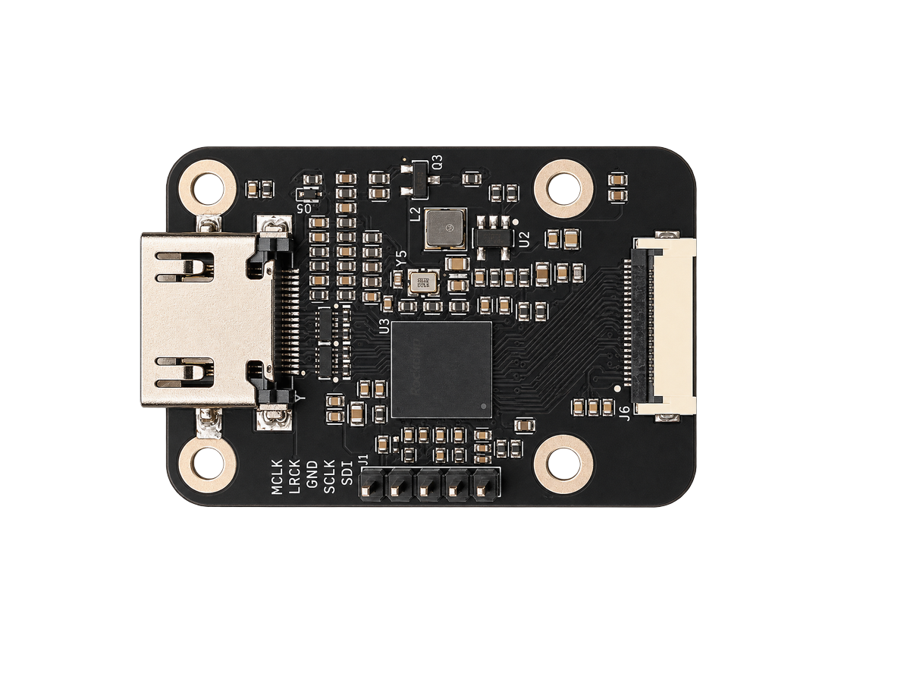
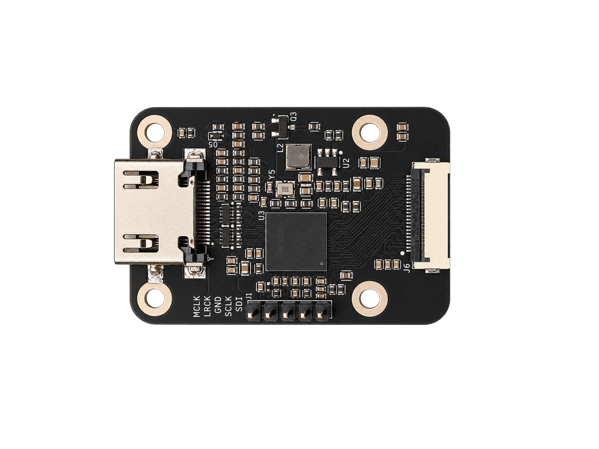
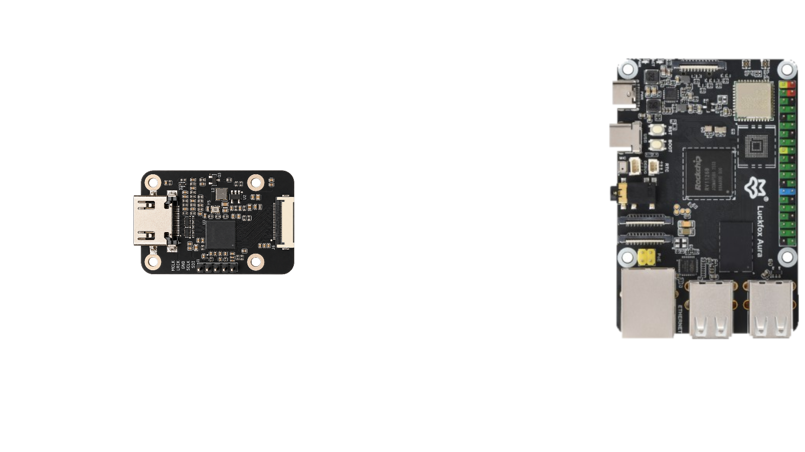

# rk628-22p: RK628H bridge, 22-pin FPC

HDMI in, 4-lane MIPI CSI-2 out over a 22-pin 0.5 mm FPC, with I2S audio on a
small header. The 22-pin connector uses the same signal order as the Raspberry
Pi camera connector, so the same board works on a **Luckfox Aura** (RV1126B)
and a **Raspberry Pi CM4**, or a Pi 4B with two lanes.



<p>
  
  
</p>

## Tested modes

300 to 1200 frames per run, on stock operating system images plus the install
steps below.

| Mode | Luckfox Aura | Raspberry Pi CM4, 4 lanes | Pi, 2 lanes (Pi 4B) |
|---|---|---|---|
| 3840x2160 @ 30 | 30.00 fps, 0 errors | 30.00 fps, 0 errors | Too fast for 2 lanes |
| 1920x1080 @ 120 | 120.00 fps, 1 error at stream start | 120.00 fps, 0 errors | Too fast for 2 lanes |
| 1920x1080 @ 60 | 60.00 fps | 60.00 fps | 60.00 fps |

EDID changes apply live on both hosts: the source switches mode within a few
seconds, with no cable replug.

## Luckfox Aura

Luckfox's own Debian 13 image has no RK628 driver, so this replaces its boot
partition with one that does. Everything else on the board stays stock,
including Wi-Fi.

1. Flash Luckfox's Debian 13 image for the Aura (SD card or eMMC).
2. Power off. Connect the bridge to the Aura's **CSI0** connector with a 22-pin
   0.5 mm FPC cable, as in the picture above. Connect an HDMI source.
3. Power on, download `rk628-aura-boot-6.1.141.tar.gz` from the
   [releases page](https://github.com/WarpKVM/rk628-bridge-boards/releases),
   copy it to the Aura, then:

```bash
tar xf rk628-aura-boot-6.1.141.tar.gz
sudo sh rk628-aura-boot/install.sh rk628-22p
```

4. Unplug the Aura and plug it back in. Don't use `reboot`: a warm reboot does
   not reset the bridge cleanly.
5. Check it:

```bash
sudo sh rk628-aura-boot/rk628-check.sh
```

```
Bridge:  /dev/v4l-subdev3
Capture: /dev/video1
Source:  3840x2160 at 30.00 Hz
Capturing 300 frames...
Measured: 30.00 fps
```

The installer saves the old boot partition to `/root` before writing. To go
back to stock, write Luckfox's own `boot.img` (it is in their image download)
the same way: `sudo sh rk628-aura-boot/install.sh /path/to/boot.img`.

### Connections on the Aura

**Video and control** go over the FPC into the Aura's CSI0 port.

| Signal | Aura net | SoC pin | Device tree |
|---|---|---|---|
| MIPI clock and data 0 to 3 | `CSI0_RX_CLK`, `CSI0_RX_D0..D3` | D-PHY0 | `csi2-dphy0` and `mipi0-csi2` |
| I2C SCL / SDA | `CSI0_I2C4_SCL` / `SDA` | GPIO4_A6 / A7 | RK628 at 0x50 on i2c-4 |
| RK628 reset | `CSI0_IO1` | GPIO4_B0 | `reset-gpios`, active low |
| RK628 interrupt | `CSI0_IO0` | GPIO4_A0 | level high |

**Audio** does not use the FPC. Three wires go from the bridge's I2S header to
the Aura's 40-pin header. The bridge is the I2S master; leave MCLK unconnected.
We have not tested audio with this boot image yet.

| Bridge header | Aura signal | SoC pin | Header pin |
|---|---|---|---|
| SCLK | SAI1_SCLK_M2 | GPIO5_C5 | 12 |
| LRCK | SAI1_LRCK_M2 | GPIO5_C6 | 16 |
| SDI | SAI1_SDI_M2 | GPIO5_C7 | 18 |
| GND | GND | | 14 or 20 |

## Raspberry Pi CM4 and Pi 4B

The driver builds on the Pi itself against Raspberry Pi OS's kernel headers.
[`../hosts/raspberry-pi-cm4/`](../hosts/raspberry-pi-cm4/) has the details.

1. Install Raspberry Pi OS Lite (64-bit). Power off and connect the bridge to
   the 4-lane camera port (**CAM1** on a CM4) with a 22-pin cable, straight
   through. On a Pi 4B, use a 22-pin to 15-pin camera adapter cable.
2. Power on, then:

```bash
wget https://github.com/WarpKVM/rk628-bridge-boards/archive/refs/heads/main.tar.gz
tar xf main.tar.gz
cd rk628-bridge-boards-main/hosts/raspberry-pi-cm4
sudo sh install.sh
sudo reboot
```

3. After the reboot: `sh ../rk628-check.sh`

Options for `install.sh`, added to the overlay line in `config.txt`:

| Option | Use it when |
|---|---|
| `2lane` | The port has two lanes: Pi 4B, or CM4 CAM0. Tops out at 1080p60 |
| `int_gpio=<n>` | Your carrier wires connector pin 18 to SoC GPIO n. On the WarpKVM CM4 carrier this is `int_gpio=26`. Without it the driver polls once a second |
| `reset_gpio=<n>` | Your carrier wires pin 17 to SoC GPIO n instead of the camera power line |

If the headers are missing, `sudo apt install linux-headers-rpi-v8` first.
Undo with `sudo sh uninstall.sh`.

## Files

| Path | What |
|---|---|
| `schematic/RK628H-22P-RevA-schematic.pdf` | Schematic |
| `cad/` | Fusion archive (`.f3z`) and EAGLE schematic and board (`.sch`, `.brd`), which KiCad can import |
| `fab/gerbers/` | Gerbers and drill file |
| `fab/bom-jlcpcb.csv`, `fab/cpl-jlcpcb.csv` | BOM and pick-and-place in JLCPCB format, plus the not-fitted lists |
| `fab/fab-notes.txt` | Stackup, impedance, finish and drill table |
| `images/` | Photo, dimensions, connection diagram, and one image per layer made from the gerbers |
| `../hosts/luckfox-aura/` | Aura device trees, boot image installer and build notes |
| `../hosts/raspberry-pi-cm4/` | Pi driver, overlay and installer |

## RK628D or RK628H

These boards are built with the RK628H, and every number here is from the H.
The RK628D also works on the single-link boards and with the same driver, and
is probably the better choice for them: the H's main extra is the dual-link
split for 4K60, which a single 4-lane link doesn't use. The driver limits the
RK628D to 1500 Mbps per lane, which still covers 4K30 and 1080p120 (1300 Mbps).
For the rk628-2x22p, use the H.

## Revision note

The boards these results come from used an XFCN F0504-H-22-20T-R FPC
connector. The released files use a GUOCONN 0.5K-GX-22PWB-R instead, because
JLCPCB soldered the old part poorly. Both are 22-pin, 0.5 mm pitch, right angle,
flip-top and dual contact, so the cable and pinout are unchanged.

## Known limitations

- Connect the bridge before power on. Plugged in later, it stays dead until a
  full power cycle.
- One capture at a time.
- The bridge uses the camera port, so the host's own camera can't be used on it.
