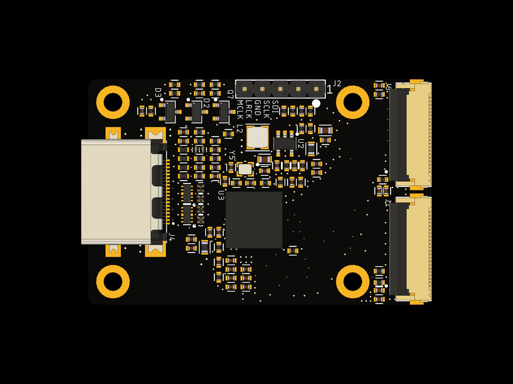

# rk628-2x22p: RK628H bridge, dual 22-pin FPC

HDMI in, two 4-lane MIPI CSI-2 links out over two 22-pin 0.5 mm FPCs. Above a
300 MHz pixel clock the RK628H splits each frame left and right across both
links, which is what carries 4K60. The host joins the halves back together.



A render from the Fusion design. Photos follow once the first boards are built.
Gerber renders of the top and bottom are in `images/render-top-store.png` and
`images/render-bottom-store.png`.

## Status

This board has not been fabricated yet. It uses the same circuit and FPC wiring
as our DIY WarpKVM shield for the Luckfox Aura, in a new layout, so the results
below are from the shield. To be tested on the final board.

| Mode | Luckfox Aura, DIY shield |
|---|---|
| 3840x2160 @ 60 | 60.00 fps over 600 frames, 0 errors, halves line up |

Measured on Luckfox's stock Debian 13 image with the `rk628-2x22p` boot image
below. The driver switches to dual link by itself for any mode above 300 MHz
and uses one link below that.

## Luckfox Aura

1. Flash Luckfox's Debian 13 image for the Aura (SD card or eMMC).
2. Power off. Connect **J1 to the Aura's CSI0** and **J6 to CSI1**. J1 carries
   the I2C, reset and interrupt lines, so it must go to CSI0. Connect an HDMI
   source.
3. Power on, download `rk628-aura-boot-6.1.141.tar.gz` from the
   [releases page](https://github.com/WarpKVM/rk628-bridge-boards/releases),
   copy it to the Aura, then:

```bash
tar xf rk628-aura-boot-6.1.141.tar.gz
sudo sh rk628-aura-boot/install.sh rk628-2x22p
```

4. Unplug the Aura and plug it back in (not `reboot`), then:

```bash
sudo sh rk628-aura-boot/rk628-check.sh
```

For 4K60, load [`2160p60.hex`](../hosts/edid/2160p60.hex) with
`sudo v4l2-ctl -d /dev/v4l-subdev3 --set-edid=pad=0,file=2160p60.hex,format=hex`
and set the source to 60 Hz.

## Files

| Path | What |
|---|---|
| `schematic/RK628H-2x22P-RevA-schematic.pdf` | Schematic |
| `cad/` | Fusion archive (`.f3z`) and EAGLE schematic and board (`.sch`, `.brd`), which KiCad can import |
| `fab/gerbers/` | Gerbers and drill file |
| `fab/bom-jlcpcb.csv`, `fab/cpl-jlcpcb.csv` | BOM and pick-and-place in JLCPCB format, plus the not-fitted lists |
| `fab/fab-notes.txt` | Stackup, impedance, finish and drill table |
| `images/` | Renders and one image per layer, made from the gerbers |
| `../hosts/luckfox-aura/dts/` | Dual link device tree for the Aura |
