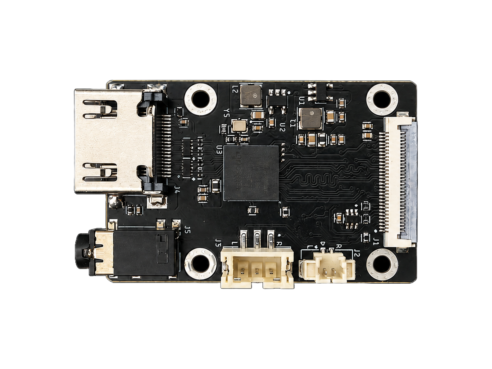
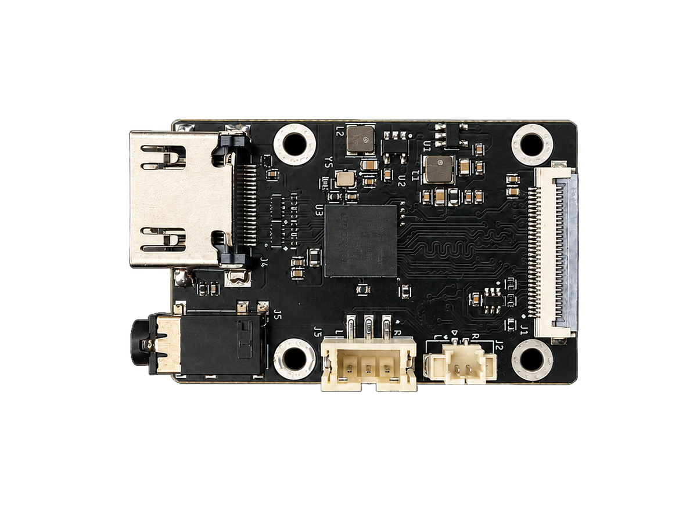
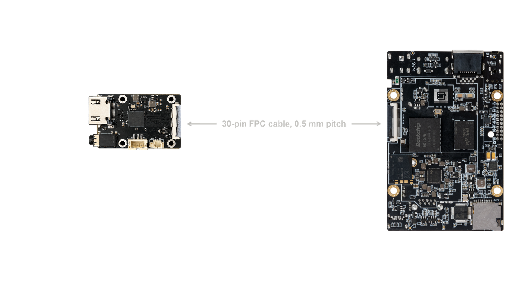

# rk628-30p: RK628H bridge, 30-pin FPC

HDMI in, 4-lane MIPI CSI-2 out over a 30-pin FPC, with an on-board audio DAC and
3.5 mm jack. Designed for and tested on the **Firefly ROC-RK3576-PC**. This is the
board the WarpKVM capture pipeline was written and measured on.



<p>
  
  
</p>

## Quick start: factory firmware, nothing to install

Firefly's factory Ubuntu 22.04 image (kernel 6.1.84) already includes an RK628
driver, so the board captures out of the box.

1. Power the Firefly off. Connect the bridge to the MIPI CSI connector with a
   30-pin 0.5 mm FPC cable, as in the picture above.
2. Connect an HDMI source to the bridge.
3. Power on. Then on the Firefly:

```bash
wget https://raw.githubusercontent.com/WarpKVM/rk628-bridge-boards/main/hosts/rk628-check.sh
sh rk628-check.sh
```

You should see something like:

```
Bridge:  /dev/v4l-subdev3
Capture: /dev/video0
Source:  1920x1080 at 60.00 Hz
Capturing 300 frames...
Measured: 60.01 fps
```

`rk628-check.sh` finds the bridge and capture devices by name, so you never
have to guess device numbers. Pass a frame count and a file name to save
frames: `sh rk628-check.sh 30 frames.nv12`.

Always connect the bridge before power on. The driver sets the chip up once at
boot, and a bridge plugged in later stays dead until a full power cycle.

### 4K on factory firmware

The factory driver's built-in EDID only offers 1080p60. To get 4K30, load a 4K
EDID and then unplug and replug the HDMI cable once (the factory driver does not
tell the source about the change; the patched kernel below does):

```bash
wget https://raw.githubusercontent.com/WarpKVM/rk628-bridge-boards/main/hosts/edid/2160p30.hex
v4l2-ctl -d /dev/v4l-subdev3 --set-edid=pad=0,file=2160p30.hex,format=hex
```

Use the bridge device `rk628-check.sh` printed. If a capture started right after
a mode change stalls, press Ctrl-C and run it again: the factory driver needs a
few seconds to settle on the new mode.

## Patched kernel: high refresh and live EDID

The patched kernel adds 1080p120 and 1080p144, EDID changes that apply without a
replug, automatic recovery when a hot replug wedges the bridge, and the audio
fixes below. It is Rockchip's public kernel with our driver fixes, built with
the factory configuration, so everything else on the board keeps working.

Download `rk628-firefly-kernel-6.1.172.tar.gz` from the
[releases page](https://github.com/WarpKVM/rk628-bridge-boards/releases), copy
it to the Firefly, then:

```bash
tar xf rk628-firefly-kernel-6.1.172.tar.gz
sudo sh rk628-firefly-kernel/install.sh
sudo reboot
```

After the reboot, `uname -r` prints `6.1.172-rk628`. The installer keeps the
factory kernel, and puts it back with:

```bash
sudo sh rk628-firefly-kernel/uninstall.sh
sudo reboot
```

To change mode, load an EDID and the source follows within a few seconds:

```bash
wget https://raw.githubusercontent.com/WarpKVM/rk628-bridge-boards/main/hosts/edid/1080p120.hex
v4l2-ctl -d /dev/v4l-subdev3 --set-edid=pad=0,file=1080p120.hex,format=hex
sh rk628-check.sh
```

If the source still sends 60 Hz, pick 120 Hz in its display settings. The EDID
offers the mode; the source decides whether to use it.

## Tested modes

300 frames per run, on a freshly flashed Firefly.

| Mode | Factory kernel 6.1.84 | Patched kernel 6.1.172 |
|---|---|---|
| 3840x2160 @ 30 | 30.00 fps, 0 errors | 30.00 fps, 0 errors |
| 1920x1080 @ 120 | Not supported | 120.00 fps, 1 error at stream start |
| 1920x1080 @ 60 | 60.01 fps, 1 error at stream start | 59.94 fps, 0 errors |

An earlier build of the same patch on kernel 6.1.141 also captured 1080p144 at
143.98 fps, 720p60 and 480p60.

## Build it yourself

The release kernel is Rockchip's `develop-6.1` branch at commit
`77168c8d5ab82399f65a80e9f807b50ba37cf483`, with
[`0001-rk628h-fixes.patch`](../hosts/firefly-rk3576/0001-rk628h-fixes.patch)
and [`config-6.1.172-rk628`](../hosts/firefly-rk3576/config-6.1.172-rk628),
which is the factory configuration plus
[`rk628h.config`](../hosts/firefly-rk3576/rk628h.config).

```bash
git init kernel && cd kernel
git fetch --depth 1 https://github.com/rockchip-linux/kernel.git 77168c8d5ab82399f65a80e9f807b50ba37cf483
git checkout FETCH_HEAD
git apply /path/to/0001-rk628h-fixes.patch
cp /path/to/config-6.1.172-rk628 .config
make ARCH=arm64 CROSS_COMPILE=aarch64-linux-gnu- olddefconfig
make ARCH=arm64 CROSS_COMPILE=aarch64-linux-gnu- -j"$(nproc)" Image modules
```

No device tree change is needed: the factory device tree already describes the
bridge, and the patched driver turns on continuous clock by itself.

## Files

| Path | What |
|---|---|
| `schematic/RK628H-30P-RevA-schematic.pdf` | Schematic |
| `cad/` | Fusion archive (`.f3z`) and EAGLE schematic and board (`.sch`, `.brd`), which KiCad can import |
| `fab/gerbers/` | Gerbers and drill file |
| `fab/bom-jlcpcb.csv`, `fab/cpl-jlcpcb.csv` | BOM and pick-and-place in JLCPCB format, plus the not-fitted lists |
| `fab/fab-notes.txt` | Stackup, impedance, finish and drill table |
| `images/` | Photo, dimensions, connection diagram, and one image per layer made from the gerbers |
| `../hosts/firefly-rk3576/` | Kernel patch, config, installer |
| `../hosts/edid/` | EDIDs for common modes, and a tool to make your own |
| `../hosts/rk628-check.sh` | Finds the bridge and checks capture |

## What the patch fixes

All of these are bugs in the vendor driver.

- **The source never sees an EDID change.** On F/H silicon the driver drops hot
  plug while writing a new EDID and never raises it again, so the source keeps
  the old mode until the cable is replugged. Fixed: the source follows within a
  few seconds.
- **The lane rate is capped at 1500 Mbps on every chip.** 1800 does not lock on
  the older RK628D, but the cap starved high refresh modes on F/H. Now it only
  applies to RK628D.
- **No continuous MIPI clock by default.** Above 60 Hz the capture side reports
  `size err` and drops frames without it. Now on by default.
- **I2S pins only partly set up, and no master clock.** Boards that feed an
  external DAC got data and no MCLK, so silence. Fixed.
- **The built-in EDID does not advertise audio**, so sources never sent any.
  Fixed.
- **A hot HDMI replug can wedge the bridge.** Every I2C access then times out.
  The patch notices and recovers in about two seconds by cycling the reset line.
- **D-PHY setup and 297 MHz timing.** PHY registers written while out of reset,
  sync widths read wrong, and an off-by-one in a timing table caused truncated
  frames and garbage resolutions at 4K30 and 1080p120.

## RK628D or RK628H

These boards are built with the RK628H, and every number here is from the H.
The RK628D also works on the single-link boards and with the same driver, and
is probably the better choice for them: the H's main extra is the dual-link
split for 4K60, which a single 4-lane link doesn't use. The driver limits the
RK628D to 1500 Mbps per lane, which still covers 4K30 and 1080p120 (1300 Mbps).
For the rk628-2x22p, use the H.

## Audio

HDMI audio goes to the on-board DAC and 3.5 mm jack, not to the SoC. It only
plays while video is being captured, because the driver turns the I2S output on
with the video pipeline.

## Known limitations

- One capture at a time. Two processes capturing from the same device can hang it.
- The bridge uses the camera connector, so the board's own camera can't be used.
- Windows caches EDIDs by product ID. If you edit EDID bytes, change the product
  ID too, or Windows keeps using its cached copy.
- Only the ROC-RK3576-PC is tested. Other carriers route CSI and GPIOs differently.
